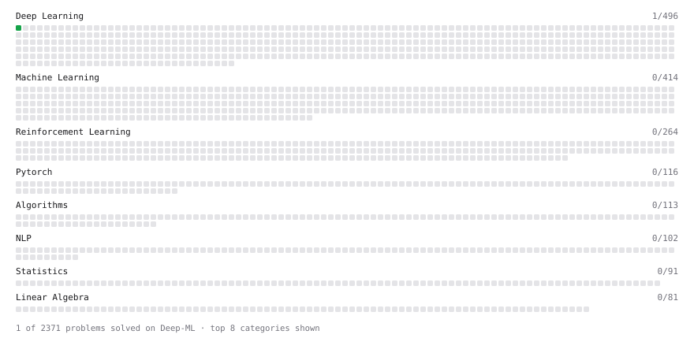

# Deep-ML

My machine learning practice from [Deep-ML](https://www.deep-ml.com). Every solution here was written by hand.

**9** solved · 9 problems · 0 labs · 0 math

[**Browse the interactive portfolio**](https://Qi-studio.github.io/deep-ml/) to replay this filling in over time.

## Problems

| | Difficulty | Solved | |
| --- | --- | --- | --- |
| [Implement ReLU Activation Function](https://www.deep-ml.com/problems/42) | easy | 2026-11-23 | [solution](problems/0042-implement-relu-activation-function) |
| [KL Divergence Between Two Normal Distributions](https://www.deep-ml.com/problems/56) | easy | 2026-11-22 | [solution](problems/0056-kl-divergence-between-two-normal-distributions) |
| [Sigmoid Activation Function Understanding](https://www.deep-ml.com/problems/22) | easy | 2026-11-22 | [solution](problems/0022-sigmoid-activation-function-understanding) |
| [Single Neuron](https://www.deep-ml.com/problems/24) | easy | 2026-11-22 | [solution](problems/0024-single-neuron) |
| [Softmax Activation Function Implementation ](https://www.deep-ml.com/problems/23) | easy | 2026-11-22 | [solution](problems/0023-softmax-activation-function-implementation) |
| [Build Scaled Dot-Product Attention](https://www.deep-ml.com/problems/490) | medium | 2026-11-24 | [solution](problems/0490-build-scaled-dot-product-attention) |
| [LoRA: Low-Rank Adaptation Forward Pass](https://www.deep-ml.com/problems/222) | medium | 2026-11-23 | [solution](problems/0222-lora-low-rank-adaptation-forward-pass) |
| [Mixture of Experts Load Balancing Loss](https://www.deep-ml.com/problems/389) | medium | 2026-11-24 | [solution](problems/0389-mixture-of-experts-load-balancing-loss) |
| [Temperature Decay Scheduler](https://www.deep-ml.com/problems/231) | medium | 2026-11-24 | [solution](problems/0231-temperature-decay-scheduler) |

---

_This file is regenerated by Deep-ML on every push._
